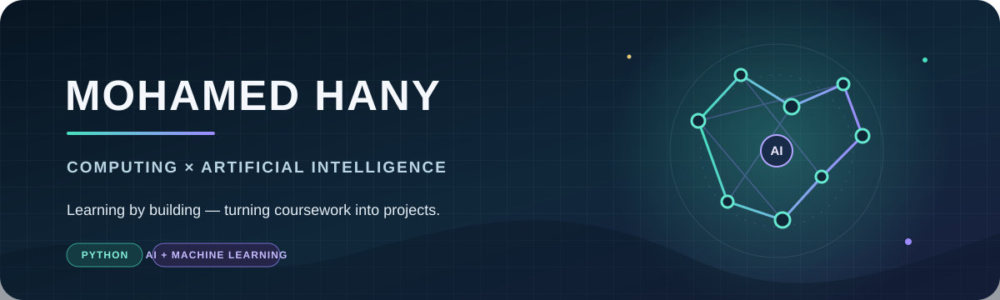

  

  <strong>Third-year Computing & Artificial Intelligence student</strong> 
  <em>Turning coursework into projects — one idea at a time.</em>

## 🚀 Projects in progress

| Track | Project | Focus | Status |
|---|---|---|---|
| **AI** | Knight's Tour | Search and problem-solving | 🟡 In progress |
| **ML · Numerical** | Student Grade Prediction | Student data | 🟡 In progress |
| **ML · Images** | Flower Recognition | Image classification | 🟡 In progress |
| **ML · Text** | SMS Spam Classification | Text classification | 🟡 In progress |

My current projects explore AI algorithms and machine learning across numerical data, images, and text.

## 🧭 Learning path

- **Currently finishing:** Artificial Intelligence and Machine Learning courses
- **Next:** Computer Vision
- **Current goal:** Build practical projects that bring my coursework to life

## 📚 Coursework & foundations

  
Explore the subjects I've studied

   

- **Programming:** C, Java, Python, Object-Oriented Programming
- **Software engineering:** SOLID, Clean Code, Design Patterns, Software Engineering I & II, Systems Analysis
- **Computer science & systems:** Data Structures, Algorithms, Discrete Mathematics, Operating Systems I & II, Computer Organization, Parallel Processing, Computer Networks
- **Data & mathematics:** SQL, Oracle SQL (PL/SQL), NumPy, pandas, Linear Algebra, Probability, Statistics, Operations Research
- **AI & ML:** Artificial Intelligence Algorithms, Machine Learning, Pattern Recognition, Deep Learning

Learning by building. Improving project by project.

